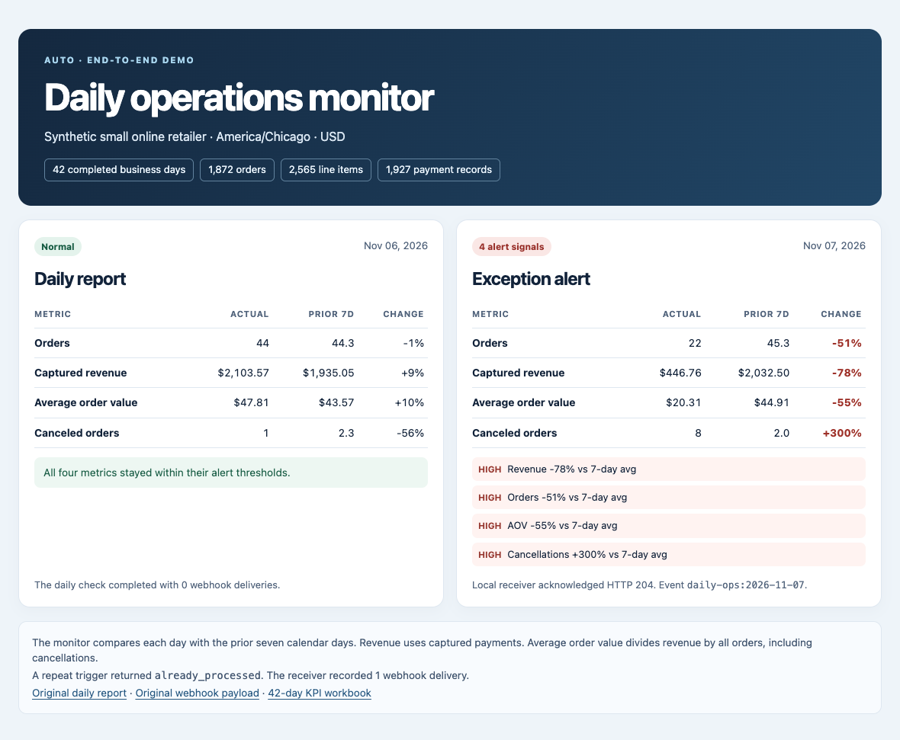

# Automated Daily Operations Monitoring

A Python monitor for daily orders, revenue, cancellations and average order value. Feed it one row per completed business day. It compares that day with the preceding seven calendar days and explains any alert. An optional daily schedule and webhook let a small team run it from an existing computer or server.

## See the daily report and alert



This run used **42 days and 1,872 synthetic orders**. On November 6 the monitor recorded a normal report with 44 orders and $2,103.57 in captured revenue. On November 7, revenue fell 78% against the prior seven-day mean and cancellations rose from a mean of 2 to 8. The scheduled check delivered one webhook with four signals. A repeated trigger returned `already_processed`.

[Normal report text](docs/demo/normal-report.txt) · [Received webhook JSON](docs/demo/webhook-alert.json)

## Run the full demo with one command

From a clone or downloaded copy of this repository, install the dependencies once with Python 3.12.

```bash
python3.12 -m venv .venv
.venv/bin/python -m pip install -r requirements.txt
```

Then run the full demo.

```bash
.venv/bin/python scripts/run_demo.py
```

On Windows, create the environment with `py -3.12 -m venv .venv` and use `.venv\Scripts\python.exe` in place of `.venv/bin/python`.

The command generates 42 days of orders, line items and payments, runs the KPI builder, checks a normal day, and starts the real scheduled service against a temporary local webhook receiver. It checks that the receiver accepted one alert and that a repeat request stays deduplicated. It closes the service when the demonstration finishes. The scenario is dated relative to the run, so the calendar dates and order totals can differ from the screenshot.

Open `demo-preview.html` in the printed `data/demo/run-*/` directory. That directory also contains the synthetic CSVs, daily KPI workbook, normal report text, received alert JSON and service log. The demo creates its own temporary token and run state and uses loopback connections.

## Connect your own daily export

1. Configure your sales or order system to export a UTF-8 CSV with this header.

   ```csv
   date,orders_count,revenue,canceled_orders,avg_order_value
   2025-03-09,10,1000.00,1,100.00
   ```

   Use local business dates in `YYYY-MM-DD` format and one currency for the file. Start with at least eight consecutive completed dates for the default seven-day baseline. Include an explicit zero row when the business had no activity. Publish each finished export by replacing the previous CSV so the monitor reads a complete file.

2. Copy `.env.example` to `.env`. Set `OPS_MODE=live`, `OPS_INPUT` to your CSV path and `OPS_TIMEZONE` to your business time zone, such as `America/Chicago`. The default CSV path is `data/daily_ops_metrics.csv` in this project.

3. Run the monitor in live mode using the configuration you just saved. It checks yesterday in your configured time zone. Use `--date YYYY-MM-DD` to check an earlier completed day.

   ```bash
   .venv/bin/python detect_anomalies.py --dry-run
   ```

   Review the date, metrics and signals. Then remove `--dry-run` to record the result and send any alert to a configured webhook. A missing date, missing baseline day or invalid CSV fails the run so you can correct the export and retry.

4. To run automatically, set `OPS_RUN_AT` to a local time after the export is usually ready, for example `08:00`. Generate a token using the command below and paste it into `OPS_AGENT_TOKEN` in `.env`.

   ```bash
   .venv/bin/python -c "import secrets; print(secrets.token_urlsafe(32))"
   .venv/bin/python run_service.py
   ```

   Keep the service running on the machine that can read the CSV. It checks yesterday once the scheduled time arrives. If the export or webhook is unavailable, it retries after five minutes during that local day. After a longer outage, check earlier dates explicitly with `--date`. With no webhook configured, review the daily result in the service log.

## Alert rules

| Metric | Medium | High |
| --- | --- | --- |
| Revenue | Drop ≥15% | Drop ≥25% |
| Orders | Drop ≥12% | Drop ≥20% |
| Average order value | Drop ≥15% | Drop ≥25% |
| Canceled or unavailable orders | Rise ≥60% | Rise ≥120% |

The baseline excludes the evaluated day. Cancellation rules compare counts. In live mode, three or more cancellations also trigger a medium alert when the baseline is zero. Set `OPS_CANCEL_ZERO_BASELINE_MIN` to change that count.

Set `OPS_ROLLING_DAYS` to change the baseline length. To override percentage thresholds, set `OPS_THRESHOLDS` to a JSON object, for example `{"revenue_drop_medium":0.20,"revenue_drop_high":0.30}`. The other rule prefixes are `orders_drop`, `aov_drop` and `cancel_spike`, each with a `_medium` and `_high` key.

## Webhooks and manual triggers

Set `OPS_WEBHOOK_URL` to the receiving URL, such as an active n8n production webhook. If the receiver uses bearer authentication, also set `OPS_WEBHOOK_TOKEN`. Live mode sends anomalies. Demo mode sends both normal and anomalous results when a webhook is configured.

The service listens on `127.0.0.1:5001` by default. Use `GET /health` to check that it is running. To trigger a run from n8n or a script on the same machine, call `POST /run` with the `X-OPS-TOKEN` header. The response includes the JSON result. A webhook delivery failure returns HTTP 502 and leaves that date eligible for retry. Use one scheduler for each export. If n8n schedules the runs, leave `OPS_RUN_AT` blank.

Live completion dates are stored in `var/live_state.json` by default. Keep that file on local disk and use the same state file for every process monitoring this export. The monitor records a date after a successful check, including a successful webhook response if an alert was sent. Repeated runs for that date return `already_processed`. A receiver that accepts an alert but loses the response can see the same alert again, so use the stable `Idempotency-Key` header to deduplicate at the receiver.

## Rebuild the original Olist demo

Download the Brazilian E-Commerce Public Dataset by Olist. Put `olist_orders_dataset.csv`, `olist_order_items_dataset.csv` and, optionally, `olist_order_payments_dataset.csv` in one directory. When payments are present, revenue comes from payment values. Otherwise, it comes from item price plus freight.

```bash
.venv/bin/python build_daily_kpi.py --data-dir /path/to/olist \
  --output-csv /path/to/output/daily_ops_metrics.csv \
  --output-xlsx /path/to/output/daily_ops_metrics.xlsx
```

Preview the bundled historical sample with `.venv/bin/python detect_anomalies.py --mode demo --dry-run`, or add `--input /path/to/output/daily_ops_metrics.csv` to use the rebuilt file. A dry run leaves the demo cursor in place. A successful demo run advances the cursor and wraps after the last eligible day. The original project write-up is in [Daily Operations Monitoring Pipeline.pdf](Daily%20Operations%20Monitoring%20Pipeline.pdf).

```bash
.venv/bin/python -m unittest discover -s tests -v
```
