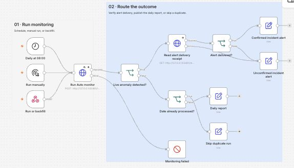
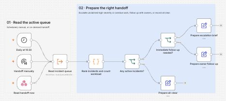

# Automated Daily Operations Monitoring



A Python monitor and six n8n workflows for daily KPIs, alert intake, incident tracking and shift handoff. The monitor compares orders, revenue, cancellations and average order value against the preceding seven calendar days.

## A real n8n demo run

The run used **42 days and 1,872 synthetic orders**. Both dates below went through the same n8n run webhook.

### Normal daily report

```text
Date: 2026-11-06 | Status: normal
Orders: 44 (avg 44.3) | Revenue: 2103.57 (avg 1935.05)
Canceled: 1 (avg 2.3) | AOV: 47.81 (avg 43.57)
Signals:
- none
```

### Alert, acknowledgement and resolution

On November 7, revenue fell **78%** to **$446.76** against the seven-day average of **$2,032.50**. Orders fell **51%**, average order value fell **55%** and cancellations rose from **2** to **8**. n8n received one alert with four high-severity signals and registered event `daily-ops:2026-11-07`.

| Step | Result in n8n | Shift handoff |
| --- | --- | --- |
| Alert delivered | HTTP 200. One incident opened. | **Escalate** the unclaimed high-severity incident. |
| Acknowledged | `Demo Operator` took ownership. | **Follow up** with the assigned operator. |
| Resolved | `Demo Lead` closed it with the note “Synthetic example. Restored checkout and verified a test order.” | **All clear**. The active queue returned zero incidents. |

Running the same date again returned `already_processed`. Replaying the alert after closure kept the existing incident closed. An attempt to resolve before acknowledgement returned HTTP 409.

<details>
<summary>See the three handoff paths in the n8n editor</summary>



</details>

[Actual run output (JSON)](docs/n8n-demo/sample-run.json) · [Six workflows and deployment setup](n8n/README.md)

## Reproduce the n8n demo

Use Python 3.12 and Node.js 22 LTS. The example was run with n8n 2.23.2. [n8n npm installation guide](https://docs.n8n.io/hosting/installation/npm/)

```bash
git clone https://github.com/Kiren-67m/automated-daily-ops-monitoring.git
cd automated-daily-ops-monitoring
python3.12 -m venv .venv
.venv/bin/python -m pip install -r requirements.txt
npm install -g n8n@2.23.2
.venv/bin/python scripts/run_n8n_demo.py --keep-open
```

The last command generates the orders, builds the daily KPIs, starts Auto and a fresh n8n instance on loopback, imports all six workflows, and runs the normal day and full incident lifecycle. It creates the demo tokens for you. The dates are relative to the day you run it.

1. Open the printed **Workflow UI** URL and complete n8n’s local owner setup.
2. Open **Auto · Daily monitoring → Executions**. Select the first successful run and open **Daily report**. The anomaly run ends at **Confirmed incident alert**.
3. Open **Auto · Incident actions → Executions** to inspect the acknowledgement and resolution. Open **Auto · Shift handoff → Executions** to compare the escalation, follow-up and all-clear branches.
4. Find reports, receipts and handoffs in `data/n8n-demo/run-*/n8n-results.json`. Press Ctrl+C when you finish exploring. Omit `--keep-open` for an automated run that exits after verification.

On Windows, create the environment with `py -3.12 -m venv .venv` and use `.venv\Scripts\python.exe` in place of `.venv/bin/python`.

### Run the Python-only demo

```bash
.venv/bin/python scripts/run_demo.py
```

This demo runs the scheduled Python service against a local test receiver. The receiver returns HTTP 503 on its first attempt. The service retries the saved event and verifies that the receiver accepts it once.

Open `demo-preview.html` in the printed `data/demo/run-*/` directory. That directory also contains the synthetic CSVs, daily KPI workbook, normal report text, received alert JSON, report history, and service log. The demo creates its own temporary token and run state and uses loopback connections.

## Connect your own daily export

1. Configure your sales or order system to export a UTF-8 CSV with this header.

   ```csv
   date,orders_count,revenue,canceled_orders,avg_order_value
   2025-03-09,10,1000.00,1,100.00
   ```

   Use local business dates in `YYYY-MM-DD` format and one currency for the file. Start with at least eight consecutive completed dates for the default seven-day baseline. Include an explicit zero row when the business had no activity. Publish each finished export by replacing the previous CSV so the monitor reads a complete file.

2. Copy `.env.example` to `.env`. Set `OPS_MODE=live`, `OPS_INPUT` to your CSV path and `OPS_TIMEZONE` to your business time zone, such as `America/Chicago`. The default CSV path is `data/daily_ops_metrics.csv` in this project.

3. Run the monitor in live mode using the configuration you just saved. It checks yesterday in your configured time zone. Use `--date YYYY-MM-DD` to check an earlier completed day.

   ```bash
   .venv/bin/python detect_anomalies.py --dry-run
   ```

   Review the date, metrics and signals. Then remove `--dry-run` to record the result and send any alert to a configured webhook. A missing date, missing baseline day or invalid CSV fails the run so you can correct the export and retry.

4. To run automatically, set `OPS_RUN_AT` to a local time after the export is usually ready, for example `08:00`. Generate a token using the command below and paste it into `OPS_AGENT_TOKEN` in `.env`.

   ```bash
   .venv/bin/python -c "import secrets; print(secrets.token_urlsafe(32))"
   .venv/bin/python run_service.py
   ```

   Keep the service running on the machine that can read the CSV. It checks yesterday once the scheduled time arrives. If the export or webhook is unavailable, it retries after five minutes during that local day. After a longer outage, check earlier dates explicitly with `--date`. With no webhook configured, review the daily result in the service log.

## Alert rules

| Metric | Medium | High |
| --- | --- | --- |
| Revenue | Drop ≥15% | Drop ≥25% |
| Orders | Drop ≥12% | Drop ≥20% |
| Average order value | Drop ≥15% | Drop ≥25% |
| Canceled or unavailable orders | Rise ≥60% | Rise ≥120% |

The baseline excludes the evaluated day. Cancellation rules compare counts. In live mode, three or more cancellations also trigger a medium alert when the baseline is zero. Set `OPS_CANCEL_ZERO_BASELINE_MIN` to change that count.

Set `OPS_ROLLING_DAYS` to change the baseline length. To override percentage thresholds, set `OPS_THRESHOLDS` to a JSON object, for example `{"revenue_drop_medium":0.20,"revenue_drop_high":0.30}`. The other rule prefixes are `orders_drop`, `aov_drop` and `cancel_spike`, each with a `_medium` and `_high` key.

## Webhooks and manual triggers

Set `OPS_WEBHOOK_URL` to the receiving URL, such as an active n8n production webhook. If the receiver uses bearer authentication, also set `OPS_WEBHOOK_TOKEN`. Live mode sends anomalies. Demo mode sends both normal and anomalous results when a webhook is configured.

The service listens on `127.0.0.1:5001` by default. Use `GET /health` to check that it is running. To trigger a run from n8n or a script on the same machine, call `POST /run` with the `X-OPS-TOKEN` header. The response includes the JSON result. A webhook delivery failure returns HTTP 502 and leaves that date eligible for retry. Use one scheduler for each export. If n8n schedules the runs, leave `OPS_RUN_AT` blank.

Use the same token with `GET /reports` to list saved days and delivery status. Add `?date=YYYY-MM-DD` to retrieve one report with its metrics, baseline and delivery attempts. The history records normal days, alerts and pending retries. A retry uses the saved payload and event ID. Previously completed dates from older state files remain deduplicated and appear in report history only if a report was saved.

Live reports and completion dates are stored in `var/live_state.json` by default. Keep that file on local disk and use the same state file for every process monitoring this export. The monitor records a date after a successful check, including a successful webhook response if an alert was sent. Repeated runs for that date return `already_processed`. A receiver that accepts an alert but loses the response can see the same alert again, so use the stable `Idempotency-Key` header to deduplicate at the receiver.

## Rebuild the original Olist demo

Download the Brazilian E-Commerce Public Dataset by Olist. Put `olist_orders_dataset.csv`, `olist_order_items_dataset.csv` and, optionally, `olist_order_payments_dataset.csv` in one directory. When payments are present, revenue comes from payment values. Otherwise, it comes from item price plus freight.

```bash
.venv/bin/python build_daily_kpi.py --data-dir /path/to/olist \
  --output-csv /path/to/output/daily_ops_metrics.csv \
  --output-xlsx /path/to/output/daily_ops_metrics.xlsx
```

Preview the bundled historical sample with `.venv/bin/python detect_anomalies.py --mode demo --dry-run`, or add `--input /path/to/output/daily_ops_metrics.csv` to use the rebuilt file. A dry run leaves the demo cursor in place. A successful demo run advances the cursor and wraps after the last eligible day. The original project write-up is in [Daily Operations Monitoring Pipeline.pdf](Daily%20Operations%20Monitoring%20Pipeline.pdf).

```bash
.venv/bin/python -m unittest discover -s tests -v
```
