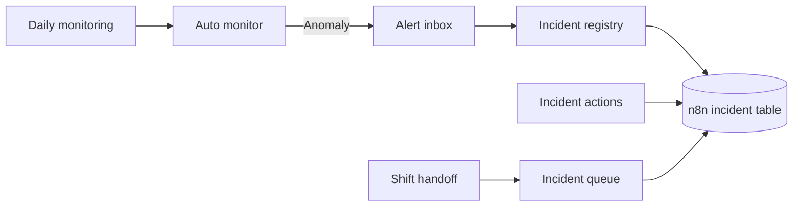

# Run Auto from n8n

Auto calculates daily KPIs, checks alert rules, and stores each result. n8n runs the workflow and records the execution. The six workflow files can be imported into n8n 2.x. Put them in the same n8n project so they can share the incident table and call each other.

| Workflow | What it does |
| --- | --- |
| [Daily monitoring](daily-monitor.json) | Runs Auto every day at 08:00 in America/Chicago or on demand. Routes normal results, duplicates, failures and live alerts. It reads the recorded delivery status for live alerts. |
| [Alert inbox](alert-inbox.json) | Receives a token-authenticated webhook request, shapes the alert and waits for the registry receipt. |
| [Incident registry](incident-registry.json) | Prepares the n8n Data Table and upserts incidents by event ID. |
| [Incident actions](incident-actions.json) | Routes acknowledgements and resolutions through separate guarded updates, with distinct responses for invalid input and state conflicts. |
| [Incident queue](incident-queue.json) | Lists open and acknowledged incidents for the operations team. |
| [Shift handoff](shift-handoff.json) | Runs at 16:30 in America/Chicago and prepares one of three handoff briefs: escalation, follow-up or all clear. |



## Run the synthetic integration demo

Install the Python and n8n dependencies from the [project README](../README.md#reproduce-the-n8n-demo). Run this from the project root.

```bash
.venv/bin/python scripts/run_n8n_demo.py --keep-open
```

The script starts a fresh loopback n8n instance, imports and publishes all six workflows, and launches Auto on a separate loopback port. It submits a normal day, an abnormal day, and the same abnormal day again through the n8n run webhook. It also confirms and closes the incident, rejects invalid or out-of-order actions, and replays the same alert to verify that it stays closed. It checks the queue before the first alert and verifies that the handoff includes an open or acknowledged incident and clears it after closure. Reports, receipts, queue snapshots and handoffs are written to `n8n-results.json` in the printed output directory. `--keep-open` keeps the local workflow editor available until Ctrl+C. The editor of a fresh instance prompts for local owner setup. This instance uses a separate data directory and temporary tokens.

## Connect an existing n8n instance

1. Import the six JSON files into the same n8n project. Check that each Execute Sub-workflow node points to the intended imported workflow. Create and attach these Header Auth credentials.

   | Credential | Header | Value |
   | --- | --- | --- |
   | Auto Service Token | `X-OPS-TOKEN` | Auto's `OPS_AGENT_TOKEN` |
   | Auto Alert Bearer | `Authorization` | `Bearer ` followed by Auto's `OPS_WEBHOOK_TOKEN` |
   | Auto Operator Token | `Authorization` | `Bearer ` followed by a separate operator token for the run, incident-action, queue and handoff webhooks |

2. In **Daily monitoring**, point **Run Auto monitor** and **Read alert delivery receipt** to `/run` and `/reports` on the Auto service. The template uses `http://127.0.0.1:5001` for processes on the same host. Set the workflow time zone and schedule to match the data export.
3. Publish **Incident registry**, **Incident queue**, **Alert inbox** and **Incident actions**. Copy the production webhook URL from **Alert inbox** into Auto's `OPS_WEBHOOK_URL`. Set `OPS_WEBHOOK_TOKEN` and leave `OPS_RUN_AT` empty so n8n controls the schedule. Start Auto in live mode.
4. Run **Daily monitoring** manually and inspect the executed branch. Then publish **Daily monitoring** and **Shift handoff** to enable their schedules. The **Run or backfill** webhook accepts `{"date":"YYYY-MM-DD"}` for a completed date. A normal day ends at **Daily report**. A live anomaly includes an `alert_delivery` value from the report history. Delivered alerts also have an **Alert inbox** execution and an incident row.

## Work an incident

The incident registry creates the `auto_ops_incidents` table when it first receives an alert or a queue request. Open **Data tables** in the same n8n project to inspect the row. A newly opened row has a blank status column, which the alert receipt displays as `open`.

Send the operator bearer token and a JSON body to **Incident actions** at `POST /webhook/auto-monitor/incidents/action`. Use the event ID from **Alert inbox**.

```json
{"event_id":"daily-ops:2026-11-07","action":"acknowledge","operator":"Operations desk"}
```

```json
{"event_id":"daily-ops:2026-11-07","action":"resolve","operator":"Operations lead","note":"Verified that checkout recovered and confirmed a test order."}
```

Confirmation records who took the event and when. Resolution requires a note and a prior confirmation. Invalid fields return HTTP 400. An unknown event or an out-of-order transition returns HTTP 409. A replay updates the existing event details while preserving its handling status. Operator labels are supplied by the caller. The shared bearer token controls access to the workflow.

## Review the queue and handoff

Use the operator bearer token for `GET /webhook/auto-monitor/incidents` and `GET /webhook/auto-monitor/handoff`. The queue lists open and acknowledged incidents. The handoff places high-severity incidents first, then orders equal priorities by age. It shows the current operator, suggested next action and the count of incidents open for at least 24 hours. Closed incidents remain in the Data Table for review.

The handoff returns `escalate` when a high-severity incident is unclaimed or an incident has been active for at least 24 hours. It returns `follow_up` for other active work and `clear` for an empty queue. The response contains the brief and any event IDs selected for escalation.

[n8n workflow import and export](https://docs.n8n.io/workflows/export-import/) · [n8n Schedule Trigger](https://docs.n8n.io/integrations/builtin/core-nodes/n8n-nodes-base.scheduletrigger/)
